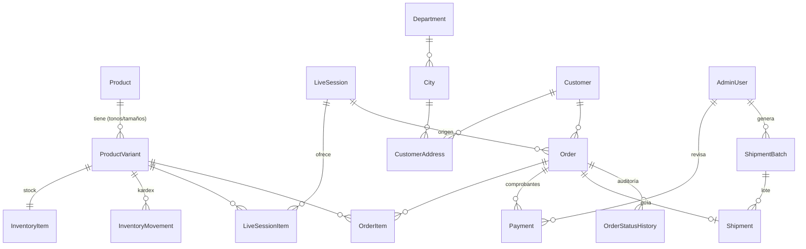

# OMS Live Commerce — Arquitectura

## 1. Visión general

```
 TikTok Live ──► link /live/:slug ──► Angular (checkout móvil) ─┐
                                                               │ REST + WebSocket
 Admin (Angular dashboard) ◄───────── Socket.IO ◄──────────────┤
                                                               ▼
                                         NestJS API (monolito modular)
                                           │        │            │
                                     PostgreSQL   Storage     Agregador logístico
                                    (fuente de    (comprob.,   (MiPaquete / Skydropx)
                                      verdad)      guías PDF)
```

**Decisión: monolito modular en NestJS + solo PostgreSQL.** Mongo no hace falta:
los datos son fuertemente relacionales (pedido → ítems → variantes → inventario) y
necesitan transacciones ACID para no sobrevender. Lo poco semiestructurado (respuesta
cruda del agregador logístico) va en una columna `JSONB` (`Shipment.rawResponse`).

## 2. Modelo entidad-relación

El esquema completo está en [`backend/prisma/schema.prisma`](../backend/prisma/schema.prisma)
y el SQL resultante en [`backend/prisma/migrations/20261015000000_init/migration.sql`](../backend/prisma/migrations/20261015000000_init/migration.sql).



Decisiones clave del modelo:

| Decisión | Por qué |
|---|---|
| `ProductVariant` como unidad vendible (SKU) | En cosméticos el stock es por tono/tamaño, no por producto. |
| `InventoryItem` separado con `onHand` y `reserved` | Es la fila "caliente" del Live; aislada para que los locks sean cortos. `disponible = onHand - reserved`. |
| `InventoryMovement` (kardex) | Trazabilidad de cada unidad: quién, cuándo, por qué pedido. |
| Dinero en `Int` COP | El peso no usa centavos; evita errores de punto flotante. |
| Snapshot de dirección y precios en `Order`/`OrderItem` | El pedido no cambia si el cliente edita su dirección o cambia el precio después. |
| Códigos DANE en `Department`/`City` | Las transportadoras colombianas los exigen para cotizar y generar guías. |
| `Order.publicToken` | El cliente consulta su pedido y sube el comprobante sin cuenta ni login. |
| `Order.idempotencyKey` | Doble clic o reintento de red no crea pedidos duplicados. |
| `LiveSession` + `LiveSessionItem` | Cada Live tiene su link, su catálogo y precios especiales. |

## 3. Estructura de carpetas del backend

```
backend/
├── prisma/
│   ├── schema.prisma              # Modelo de datos
│   ├── migrations/                # SQL versionado (incluye CHECK constraints)
│   └── seed.ts                    # Admin inicial, DANE, productos demo, Live demo
├── scripts/
│   └── stress-reserve.ts          # Prueba de concurrencia: N compradores por el último labial
└── src/
    ├── main.ts
    ├── app.module.ts
    ├── config/                    # Validación de variables de entorno
    ├── common/                    # Transversal: guards, decoradores, filtros, utilidades
    │   ├── auth/                  #   AdminAuthGuard, @CurrentAdmin
    │   ├── filters/               #   Prisma → HTTP (P2002 → 409, P2025 → 404)
    │   └── utils/
    ├── infrastructure/            # Adaptadores técnicos (sin reglas de negocio)
    │   ├── prisma/                #   PrismaService
    │   ├── storage/               #   Disco local hoy, S3/R2 mañana (misma interfaz)
    │   └── realtime/              #   Gateway Socket.IO (stock y eventos admin)
    └── modules/                   # Módulos de negocio
        ├── auth/                  # Login admin (JWT)
        ├── catalog/               # Productos y variantes
        ├── inventory/             # Reservas atómicas, ajustes, kardex, job de expiración
        ├── live-sessions/         # Lives y sus productos
        ├── locations/             # Departamentos y ciudades
        ├── checkout/              # API pública: catálogo del Live, crear pedido, subir comprobante
        ├── orders/                # Admin: listado, detalle, cancelación, máquina de estados
        ├── payments/              # Admin: aprobar / rechazar comprobantes
        ├── shipping/              # Proveedores logísticos (patrón adapter) y lotes de guías
        └── dashboard/             # KPIs del día
```

Regla de dependencias: `modules → infrastructure → (Prisma, disco, red)`. Los módulos de
negocio no hablan entre sí por la BD de otro módulo: usan el servicio exportado
(p. ej. `checkout` y `payments` usan `InventoryService`, nunca SQL de inventario propio).

## 4. Concurrencia de inventario ("el último labial")

### El problema

Durante el Live, 200 personas abren el link en el mismo segundo. Si el código hace
`SELECT stock` → `if (stock >= 1)` → `UPDATE stock = stock - 1`, dos peticiones leen
`stock = 1`, ambas pasan el `if`, y se venden 2 unidades que no existen
(condición de carrera *read-modify-write*).

### La solución: reserva con UPDATE condicional atómico

La verificación y la escritura ocurren en **una sola sentencia**:

```sql
UPDATE inventory_items
SET    reserved = reserved + $cantidad
WHERE  "variantId" = $id
  AND  "onHand" - reserved >= $cantidad;   -- condición evaluada sobre la fila bloqueada
```

PostgreSQL toma un lock de fila. La segunda transacción espera; cuando la primera hace
commit, PostgreSQL **re-evalúa el WHERE con el valor nuevo** (READ COMMITTED), no se cumple,
y devuelve `0 filas afectadas` → respondemos `409 Agotado`. Sin `SELECT ... FOR UPDATE`
explícito, sin locks de tabla, sin colas: el lock dura milisegundos.

Implementación: [`inventory.service.ts`](../backend/src/modules/inventory/inventory.service.ts).

### Las 5 capas de la estrategia

1. **Reserva al crear el pedido, no al pagar.** El checkout aparta las unidades
   (`reserved += n`) con un TTL (`LiveSession.reservationMinutes`, 30 min por defecto).
   El cliente que llegó primero se queda con el labial mientras sube el comprobante.
2. **UPDATE condicional dentro de una transacción multi-ítem.** Si el carrito trae 3
   productos y el tercero está agotado, la transacción hace rollback y los otros dos se
   liberan solos. Los ítems se procesan **ordenados por `variantId`** para que dos carritos
   con los mismos productos en distinto orden no hagan *deadlock*.
3. **CHECK constraints en PostgreSQL** (`reserved <= onHand`, `>= 0`): aunque un bug de la app
   intentara sobrevender, la base de datos rechaza la escritura.
4. **Transiciones de estado idempotentes.** Cada cambio de estado es
   `UPDATE orders SET status = B WHERE id = X AND status = A`. Si el job de expiración y el
   admin aprobando el pago chocan, solo uno gana (el otro ve 0 filas) y el stock nunca
   se libera dos veces.
5. **Job de expiración** (cada minuto): pedidos `PENDING_PAYMENT` con `reservedUntil < now()`
   pasan a `EXPIRED` y devuelven `reserved` al disponible. Cada cambio se emite por
   WebSocket para que los demás compradores vean "¡Quedan 2!" en vivo.

Ciclo de vida de una unidad:

```
checkout        → reserved += n            (RESERVE)
pago aprobado   → onHand -= n, reserved -= n (SALE)
rechazo/expira  → reserved -= n            (RELEASE)
cancelar pagado → onHand += n              (RETURN)
```

### ¿Y si el volumen crece mucho?

Una fila caliente en PostgreSQL soporta del orden de cientos a miles de reservas por
segundo para un mismo SKU (cada lock dura ~1-3 ms), muy por encima de lo que genera un
Live de una tienda de cosméticos. Si algún día no alcanza, el siguiente paso es poner un
contador en **Redis con un script Lua** (`DECRBY` condicional) como filtro rápido delante
de PostgreSQL, que sigue siendo la fuente de verdad. No se implementa ahora porque añade
infraestructura sin necesidad real.

`scripts/stress-reserve.ts` lanza N checkouts simultáneos contra una variante con stock 1
y verifica que exactamente uno gane.

## 5. Flujos principales

**Checkout (público, mobile first)**
1. `GET /api/public/lives/:slug` → productos del Live con stock disponible + datos de pago.
2. `POST /api/public/lives/:slug/checkout` (header `Idempotency-Key`) → valida, reserva stock,
   crea cliente/pedido → devuelve `publicToken`. Si algo se agotó: `409 OUT_OF_STOCK` con el detalle por producto.
3. `POST /api/public/orders/:token/payment` (multipart) → sube comprobante → `PAYMENT_REVIEW`.
4. `GET /api/public/orders/:token` → seguimiento (estado, guía).

**Administración**
- `POST /api/admin/payments/:id/approve` → `PAID`, la reserva se vuelve venta.
- `POST /api/admin/payments/:id/reject` → vuelve a `PENDING_PAYMENT` con nueva ventana para re-subir.
- `POST /api/admin/shipments/batches` `{ orderIds }` → genera guías en lote; descarga un único
  PDF 4×6" con todas las guías para la impresora térmica.

**Tiempo real (Socket.IO, namespace `/realtime`)**
- Público: `stock.updated` `{ variantId, available }`.
- Admin (token JWT en el handshake): `order.created`, `payment.submitted`, `order.updated`, `batch.updated`.

## 6. Integración logística

Patrón *adapter*: `ShippingProvider` define `createShipment(order) → { trackingNumber, carrier, labelPdf }`.

- `MockShippingProvider`: genera guías PDF 100×150 mm reales para probar todo el flujo e
  imprimir en la térmica sin contrato con ningún agregador.
- `MiPaqueteProvider` / `SkydropxProvider`: esqueletos con autenticación y mapeo de campos.
  **Los endpoints y payloads deben confirmarse con la documentación y el sandbox de tu cuenta**
  antes de activarlos (`SHIPPING_PROVIDER=MIPAQUETE`).

Los lotes se procesan en segundo plano con concurrencia limitada
(`SHIPPING_BATCH_CONCURRENCY`) y cada guía guarda su resultado individual: si 3 de 40 fallan,
las otras 37 se imprimen y las 3 se reintentan. Para volúmenes altos el siguiente paso es
mover el procesamiento a BullMQ + Redis.
